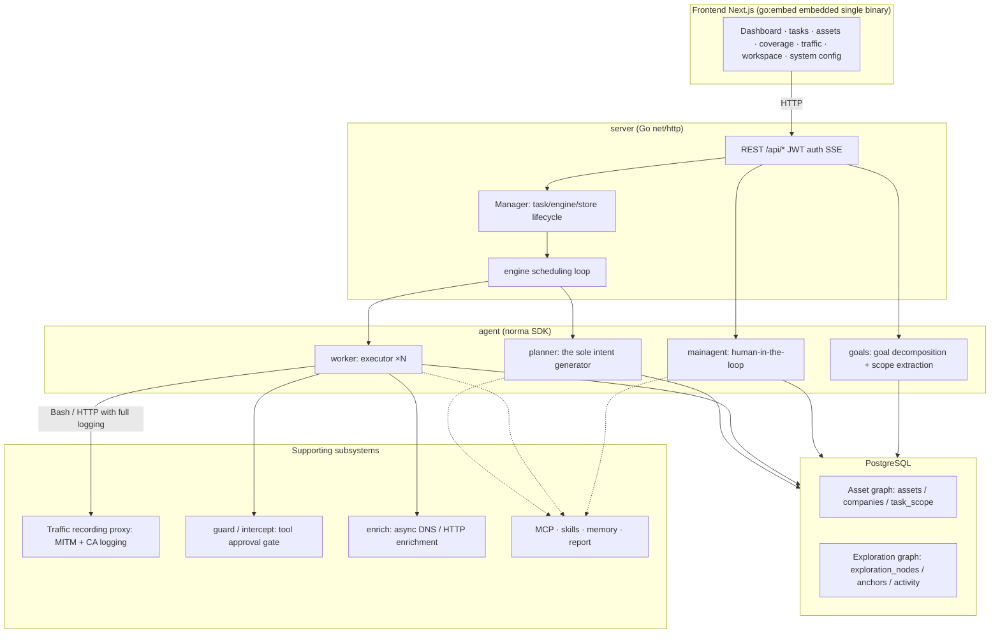
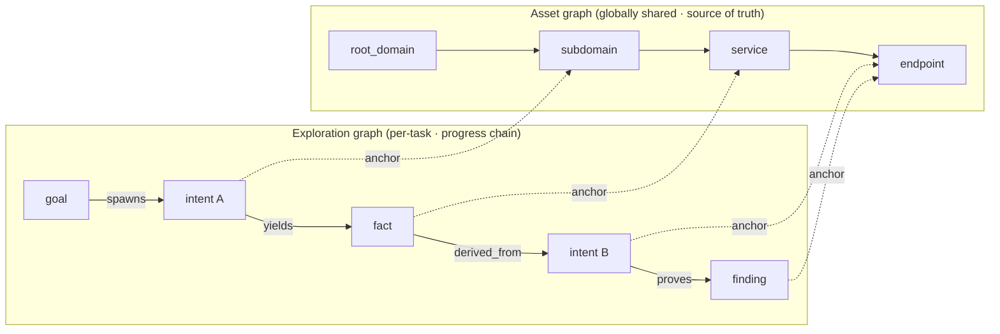
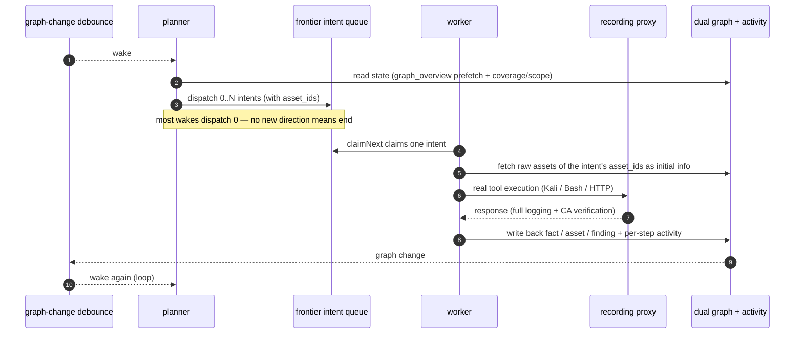
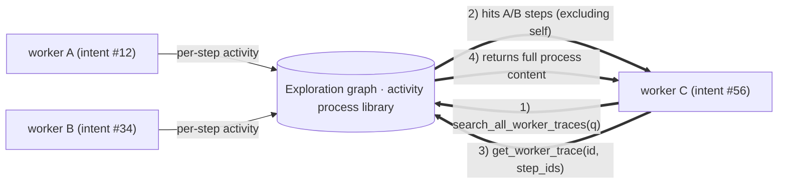
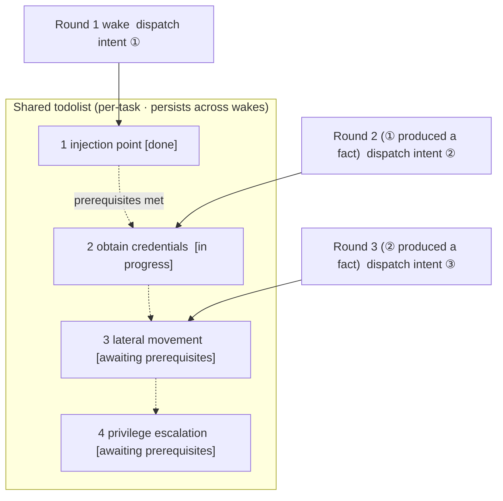

<div align="center">

# ARTEX

AI-driven autonomous penetration testing system (Go backend + Next.js frontend)

🌐 **Online Demo (mock data)**: [https://artex-demo.mhtsec.com](https://artex-demo.mhtsec.com)

📦 **This repository is the last pure-source-code backup of ARTEX. The original Docker image source `autumn27/artex` is no longer maintained — the image is now self-maintained by this repository as `mianhuatang11/artex` (Docker Hub); if the pull fails, `docker compose build` builds locally from pure source with no external pre-built dependencies.**

</div>

---

## Screenshots

> See the [Online Demo](https://artex-demo.mhtsec.com) (pure frontend + mock data, no backend needed) for the full interactive experience. UI labels are in Japanese.

| Dashboard (overview / token usage / activity) | Task list |
| :---: | :---: |
|  |  |

| Task · execution process (sessions / tool calls) | Exploration graph |
| :---: | :---: |
|  |  |

| Findings | Assets |
| :---: | :---: |
|  |  |

| Asset coverage map (force-directed · tested highlighting · node collapse/expand) |
| :---: |
|  |

| Traffic recording | Human-in-the-loop chat |
| :---: | :---: |
|  |  |

| Agent management | LLM config |
| :---: | :---: |
|  |  |

| Intercept approval | Backend logs |
| :---: | :---: |
|  |  |

---

## Approval Record Details

The global "Approval Records", per-task "Intercept Approval", and approval cards in chat all support expanded detail views. The display structure references [AegisHook's approval detail component](https://github.com/RuoJi6/AegisHook/blob/main/web/src/components/CallDetail.vue), reusing ARTEX's components and theme.

---

## Asset Sync (ScopeSentry)

Assets can be synced directly from [ScopeSentry](https://github.com/Autumn-27/ScopeSentry), eliminating duplicate collection:

- On the **Asset Sync** page, enter the ScopeSentry URL and API Key to connect the data source;
- Select the target by **project** or **task** dimension, and the asset types to sync (domains / subdomains / IPs / ports / sites / endpoints…);
- Import with one click and merge into the company asset scope, feeding directly into ARTEX's asset graph for agent exploration.

---

## Installation

> Requires a **PostgreSQL** database; exploration requires an **LLM** (`ANTHROPIC_API_KEY` or `OPENAI_API_KEY`, or configure it in the UI).

### Method 1: One-click install script (recommended)

```bash
git clone https://github.com/mhtsec/ARTEX.git
cd ARTEX
./install.sh
```

The script will: detect / install Docker automatically → let you choose **① all-Docker** or **② local build & run**:

- **① all-Docker**: enter a Postgres password (or press Enter for a random one) → writes `.env` automatically → `docker compose up -d`.
- **② local run**: choose a database (connect to an existing one / start one via Docker) → generates `config.json` → compiles the single embedded binary via `go` → starts.

After installation, open **http://localhost:8787** (you'll be taken to `/setup` on first launch to set an admin password).

### Method 2: Docker Compose (manual)

```bash
git clone https://github.com/mhtsec/ARTEX.git
cd ARTEX
cp .env.example .env          # fill in POSTGRES_PASSWORD, optional ANTHROPIC_API_KEY
docker compose up -d          # pulls the mianhuatang11/artex image + postgres
# → http://localhost:8787
```

> The original image source `autumn27/artex` has been deleted from Docker Hub; the image is now self-maintained by this repository as **`mianhuatang11/artex`**.
> When the image source is unavailable (or you want to modify the code), build locally from pure source: `docker compose build && docker compose up -d`.
> The Dockerfile is a multi-stage build (frontend static export → Go static build → runtime image) that uses China-friendly dependency sources by default; override with `--build-arg GOPROXY=... / --build-arg NPM_REGISTRY=...`.

The image includes common tools (ripgrep/curl/vim/npm/nmap…); `./skills` and `./data` are persisted via bind mounts.

Remote MCP can use `http` (Streamable HTTP) or `sse` (legacy SSE) selected in System Settings.
Legacy SSE services typically establish the event stream via `GET /sse`, then receive JSON-RPC requests through the `/message?sessionId=...` endpoint returned by the service; set the URL to `/sse` and the request header to `Authorization=Bearer <token>`.

### Method 3: Pre-compiled binary (Releases)

Download the zip for your platform from the original repo's [Releases](https://github.com/Autumn-27/ARTEX/releases) (**this backup repository does not host binaries**; if the original Releases also fail, use Method 2 or Method 4 instead). After extraction you'll have `artex` + `start.sh` (`start.bat` on Windows) + `skills/` + `config.example.json`:

```bash
cp config.example.json config.json   # fill in the database connection
./start.sh                           # → http://localhost:8787
```

> Use `start.sh` / `start.bat` to start, not `./artex` directly. It's a daemon script: it restarts the process based on the exit code, and the **one-click update on the page** relies on it to complete the swap. Running `./artex` directly means the new version won't be pulled up after an update.
> For a persistent background process: `nohup ./start.sh >artex.log 2>&1 &`.

### Method 4: Build the single binary from source

```bash
# 1) Frontend static export
cd web && npm ci && npm run build:static && cd ..
# 2) Copy into the embedded directory
cp -r web/out server/webui/dist
# 3) Build (-tags embedui embeds the frontend)
CGO_ENABLED=0 go build -tags embedui -o artex ./cmd/artex
./start.sh
```

### Method 5: Build cross-platform release archives

`build.sh` first builds and embeds the frontend, then strips debug information via the Go linker, and packages the release files into zips. Release mode by default produces Linux amd64/arm64, macOS amd64/arm64, and Windows amd64 zip archives:

```bash
./build.sh --release
# output: dist/artex-0.3.3-*.zip
```

UPX self-extracting binaries may be incompatible with some Linux kernels, virtualization environments, or security policies, so UPX is not enabled by default. Use `ARTEX_TARGETS` to customize targets; you can explicitly pass `--upx` to further shrink the binary once you've confirmed the target environment is compatible:

```bash
ARTEX_TARGETS=linux/amd64,windows/amd64 ./build.sh --release
./build.sh --target linux/amd64 --upx
```

---

## Updating

> An upgrade replaces only the program, not your data: the Postgres data volume `pgdata`, `./data` (jwt.key / SQLite, etc.), and `./skills` are all preserved. **No manual database migration is needed** — `artex` re-runs `schema.sql` idempotently on every startup (including `ADD COLUMN` / `CREATE INDEX IF NOT EXISTS`), i.e. "restart to migrate". Backing up `./data` and the database before upgrading is still recommended.

### Method 1: One-click update from the page (recommended)

On the **System Config** page (sidebar "System Config" → `/system/settings`), the **Version & Update** card lets you check for and install new versions directly, without logging into the server.

After clicking "Update": download the release for the current platform → verify against the Release's `SHA256SUMS` → smoke-test the new binary with `-h` → stage it as `artex.new` → the process exits and `start.sh` / `start.bat` pulls it up and completes the swap. The page waits automatically for the new version to come online and refreshes.

- **A failed update never leaves a broken program**: if verification or the smoke test fails, the staged file is discarded and the current version keeps running; if the swapped-in new version fails to start 3 times consecutively, it automatically rolls back to `artex.old` (the failed one is kept as `artex.failed` for diagnosis).
- **Rollback is always available**: the previous version is kept as `artex.old`, and the card has a "Roll back to previous version" option. Note that the database schema is not rolled back.
- **Updates interrupt running tasks** — an update is a restart, so perform it during idle time.
- **Dev builds are not offered updates**: the version is `dev` or a `git describe` with a suffix, updates are disabled to avoid a release overwriting a locally-debugged binary.
- **Under Docker, only the program is replaced, not the image**: toolchains like playwright / nmap in the image do not follow the upgrade, and rebuilding the container with `docker compose up -d` reverts to the image's bundled versions. To upgrade the image too, still use `docker compose pull artex && docker compose up -d artex`.
- If a proxy is needed to reach GitHub, configure the **global proxy** on the same page; the update channel routes through it. Updates only download from GitHub domains over enforced HTTPS.

### Method 2: One-click update script

```bash
cd ARTEX
./update.sh
```

The script optionally `git pull`s the latest code first, then lets you choose **① Docker update** or **② local build update** (mirroring `install.sh`):

- **① Docker**: you can specify a target image tag (press Enter to use `ARTEX_TAG` from `.env`, default `latest`) → `docker compose pull` → `docker compose up -d` (replacing the image and restarting auto-migrates).
- **② Local**: rebuild the frontend static assets → recompile `./artex` (restart the process to take effect when done).

### Method 3: Docker Compose (manual)

```bash
cd ARTEX
git pull                       # update compose / scripts (optional)
# To pin a version: set ARTEX_TAG=v0.2.0 in .env; otherwise use latest
docker compose pull artex
docker compose up -d artex     # replacing the image and restarting auto-migrates the schema
docker image prune -f          # clean up old images (optional)
```

### Method 4: Pre-compiled binary (Releases)

Download the new version's zip from [Releases](https://github.com/Autumn-27/ARTEX/releases), stop the old process, overwrite `artex` and `skills/` (keep your `config.json` and `data/`), then restart:

```bash
cp -r <extracted-dir>/skills ./ && cp <extracted-dir>/artex ./
./start.sh
```

### Method 5: Build from source

```bash
git pull
cd web && npm ci && npm run build:static && cd ..
cp -r web/out server/webui/dist
CGO_ENABLED=0 go build -tags embedui -o artex ./cmd/artex
# restart ./start.sh
```

---

## Configuration

**Database** (`config.json`, or override with the `ARTEX_PG_DSN` environment variable):

```json
{
  "database": {
    "host": "127.0.0.1", "port": 5432,
    "user": "artex", "password": "yourpass",
    "dbname": "artex", "sslmode": "disable"
  }
}
```

**LLM**: `export ANTHROPIC_API_KEY=sk-...` (or `OPENAI_API_KEY`), or fill it in on the UI's "LLM Config" page.
Optional: `ARTEX_LLM_PROVIDER` / `ARTEX_LLM_MODEL` / `ARTEX_LLM_BASE_URL` / `ARTEX_LLM_PROXY`.

**Concurrency**: the number of work agents per task is configured in "System Settings" (default 3).

**Common parameters**: `./start.sh -addr :8787 -proxy :8788` (`-addr` for frontend + API, `-proxy` for the traffic-recording proxy). The start script passes parameters through to `artex` verbatim.

### Reverse proxy deployment (HTTPS / only port 443 exposed)

The frontend and API/SSE are both served by the same backend port (default `:8787`), and the realtime activity stream defaults to a **same-origin** address, so **no `NEXT_PUBLIC_SSE_BASE` configuration is needed**; expose only port 443 publicly and keep 8787 internal.

SSE is a long connection with continuous push, so the reverse proxy **must disable buffering**, otherwise the browser connects but receives no events (the activity stream spins forever). Nginx example:

```nginx
server {
    listen 443 ssl;
    server_name your.domain.com;
    # ssl_certificate /ssl_certificate_key ...

    location / {
        proxy_pass http://127.0.0.1:8787;
        proxy_set_header Host $host;
        proxy_set_header X-Forwarded-Proto $scheme;

        # SSE essentials: disable buffering, long timeout, HTTP/1.1
        proxy_buffering off;
        proxy_cache off;
        proxy_read_timeout 3600s;
        proxy_http_version 1.1;
        proxy_set_header Connection "";
    }
}
```

> Only set `NEXT_PUBLIC_SSE_BASE` **at build time** when SSE needs a different origin than the page (e.g. a separate subdomain) — the variable is baked into the static bundle at `next build` and has no effect at container runtime.

---

## Development

### Manual vulnerability retesting

The "Retest" tab on the task detail page lets you paginate through this task's vulnerabilities, view past verdicts and evidence, and manually launch a retest. After starting, the current tab is retained with a spinning icon and "Retesting"; once a fix is confirmed, the vulnerability status updates automatically.

Click "Retest" in the per-row action area of the vulnerability list, or click "Launch Retest" in the "Vulnerability Retest" section of the vulnerability detail. Fill in an optional fixed version, test conditions, or constraints, and the system creates an independent retester Agent session while keeping the current page. The list's flat view, per-task grouping, and asset view all support this entry; while a retest runs, a spinning icon and "Retesting" are shown — click into the corresponding session to watch, and it reverts to "Retest" when finished. Retesting does not restart the original scan task; verdicts are "Still reproducible", "Fixed", or "Inconclusive", and each verdict, evidence, and session link is saved in the vulnerability detail.

The new backend pre-seeds an editable "Vulnerability Retest" (`retester`) agent on first startup; you can configure its prompt, LLM, run budget, and tools in Agent Management. It uses its bound LLM by default, or the global active configuration when unbound. When a retester session completes successfully with the verdict "Fixed", the system automatically sets the vulnerability disposition status to "Fixed"; running, failed, stopped, or other verdicts keep the original status. The original evidence and report are always preserved. You can also manually select "Fixed" in the status dropdown. The same vulnerability reuses an existing session while a retest is in progress, and can be re-launched after a stop, failure, or service restart.

Historical records for this version are viewed through the vulnerability detail and sessions; they are not yet included in vulnerability report exports or task archive packages, and are not automatically linked to traffic packages. Demo mode only generates clearly labeled simulated records and does not request real targets.

### Local run & testing

```bash
./dev.sh    # backend(:8787) + traffic proxy(:8788) + frontend next dev(:5173) → http://localhost:5173
```

- Backend: `go run ./cmd/artex` (without `-tags embedui` the frontend is not embedded)
- Frontend: `cd web && npm run dev` (proxies `/api` to the backend, with hot reload)
- Tests: `go test ./...`
- Mock preview (no backend): `cd web && NEXT_PUBLIC_MOCK=1 npm run dev`
- Redeploy the Online Demo (Cloudflare Pages, static export + mock data):
  ```bash
  cd web && NEXT_PUBLIC_MOCK=1 npm run build:static
  CLOUDFLARE_API_TOKEN=<token> npx wrangler pages deploy out --project-name=artex-demo --branch=main
  ```

---

## System Architecture

ARTEX is an **LLM multi-agent-driven autonomous penetration system**: a Go monolith backend (with an embedded Next.js frontend) + PostgreSQL, with agent capabilities provided by the [`norma`](https://github.com/Autumn-27/norma) SDK (`agentcore` / `tool` / `permission` / `harness` / `memory` / `transcript`). The core is a **dual-graph architecture**, plus two autonomy mechanisms around it: **process-level information exchange between workers** and a **multi-round shared todolist in the planner** that stabilizes attack chains.

### Overall layering



| Layer | Responsibility |
| --- | --- |
| **Frontend** | Next.js static export, embedded into the single binary via `go:embed`; visualizes tasks/assets/exploration/coverage and human-in-the-loop chat |
| **server** | `net/http` routing + JWT auth + SSE; `Manager` hosts the lifecycle of tasks, engines, and DB stores |
| **engine** | One `plannerLoop` per task + N worker goroutines; intent claiming, timeout/pause/drain |
| **agent** | goals / planner / worker / mainagent; `ToolSet` exposes the dual graph as LLM tools |
| **db** | Postgres persistence of the dual graph (pgx); the schema is created idempotently on every startup via `go:embed` |
| **Supporting** | Recording MITM proxy, approval gate, async enrichment, MCP/skills/memory/report |

### Dual-graph architecture: exploration graph + asset graph

The system splits "**what is the goal**" and "**how far have we tested**" into two independent graphs connected by anchors:

- **Asset graph (Asset Graph, globally shared)**: the single source of truth for assets across tasks. Nodes are `root_domain / subdomain / ip / service / app / endpoint`, owned by companies; parent-child relationships and dedup keys from domain → subdomain → service → endpoint are all computed by the program — agents only submit raw information.
- **Exploration graph (Exploration Graph, per-task independent)**: the "thinking and progress" process of one task. Nodes are `goal / intent / fact / finding / hint`, connected by edges like `spawns / derived_from / yields / proves` into a **lineage chain** answering "which direction was derived from which facts, and what it produced".
- **The two graphs are linked by anchors**: `exploration_anchors(node_id, asset_id)` anchors intents/facts/findings to specific assets — so you can see which assets an "exploration direction" targets, and conversely look up which intents tested an asset in this task and which facts they produced. This also underpins **asset test coverage** and the **asset coverage map** (in-scope assets + tested highlighting).



> Division of labor: the **planner** reads the exploration graph state, judges the goal, and only dispatches **intents** into the frontier when there are uncovered new directions; **workers** claim **one intent**, execute with real tools, write new assets/facts/findings back to both graphs, and stop. The asset graph is shared truth; the exploration graph is the per-task progress chain.

### Engine and intent lifecycle (one exploration loop)

The engine is an **event-driven loop**: a graph change wakes the planner, the planner dispatches intents, a worker claims an intent, executes, and writes back — the write-back triggers the next round — until the goal is proven (`prove_goal`).



### Process-level information exchange between workers

In a deep exploration, many valuable observations (an error, a response snippet, a hidden parameter) appear in one worker's **execution process** but are not necessarily written up as formal facts. To avoid duplicated effort and let workers on the chain build on each other, workers have the ability to **search processes across works**:

- `search_all_worker_traces(q)`: keyword search across **other works' execution processes in this task** (automatically excluding steps of your own intent); hits carry `intent_id`;
- `list_worker_traces` / `get_worker_trace(intent_id, step_ids=[…])`: first see which works have run, then fetch the full content of specific steps of a work for detail exchange.

This way, even when the exploration graph has no corresponding fact yet, later workers can reuse observations from others' processes — **information flows between workers at the granularity of "execution processes"**, while boundaries remain unchanged (each worker still only does the one intent it claimed).



### Planner multi-round shared todolist → stable attack chains

Real attack chains are often **multi-step sequences with dependencies** (e.g. find injection point → obtain credentials → lateral movement → privilege escalation); dispatching them all in parallel at once only creates chaos. The planner therefore holds a **planning todolist retained per task and shared across wakes**:

- The planner is event-driven — it wakes on every graph change, but **each wake is a brand-new session**; the shared todolist lets it **record a serial exploitation chain once** and then **dispatch intents step by step across subsequent rounds by dependency**, rather than fully expanding the whole chain in one round;
- Each round only dispatches intents for the next step whose "prerequisite steps are complete and the facts they depend on exist", and updates the list with progress (marking steps satisfied by facts as done).



Thus the attack chain **progresses stably, without duplication or misordering**, even in an "event-driven + stateless session" environment — this is key to ARTEX being able to autonomously complete multi-step exploitation chains.

---

## Community Group

Scan the QR code to follow the WeChat official account **SecSentry**, and send a private message to the account to join the discussion group.

<div align="center">


</div>

---

## References

https://github.com/oritera/Cairn

---

## License & Disclaimer

### Open Source License

This project is licensed under the **GNU Affero General Public License v3.0 (AGPL-3.0)**; see the [LICENSE](LICENSE) file in the repository root for the full terms.

This means anyone can freely use, modify, and distribute this project, but **derivative works must likewise be open-sourced under AGPL-3.0**; in particular, **if you modify this project and provide it to users over the network (e.g. as an online service), you must also make the corresponding complete source code available to those users**.

> ⚠️ **Important note**: the open-source license itself does not restrict the software's use. The following "usage restrictions" and "disclaimer" are additional agreements and solemn declarations by the author to users; please comply.

**ARTEX is for personal learning, code research, and local technical validation only; it must not be used to conduct actual testing against any online system or website.**

### Permitted Use

- Only for **reading, learning from, and researching the project's source code**, and for **technical principle validation in local, isolated environments**;
- Suitable for non-offensive purposes such as personal learning, academic research, and code review.

### Prohibited

- **It is strictly forbidden to use this tool to scan, probe, exploit, or attack any website, online service, or networked system** (regardless of authorization or whether it is your own asset);
- It is strictly forbidden to use this tool for any actual penetration testing, red-team/blue-team exercises, or production environments;
- It is strictly forbidden to use this tool for illegal intrusion, data theft, ransomware, denial of service, or any destructive or criminal activity;
- It is strictly forbidden to use this tool to violate the laws and regulations of your country/region.

### Compliance Responsibility

Users are responsible for complying with all laws and regulations of their country/region regarding cybersecurity, data protection, and computer crime (in mainland China, including but not limited to the Cybersecurity Law, Data Security Law, Personal Information Protection Law, and related judicial interpretations). **All legal responsibilities and consequences arising from the use of this tool are borne by the user.**

### Disclaimer

This project is provided "AS IS", without any express or implied warranty. The author and contributors are not liable for any direct or indirect loss, data loss, system damage, or legal disputes arising from the use of this tool (regardless of whether the use is appropriate). **Downloading, installing, or using this project means you have read, understood, and agreed to all the above terms.**
