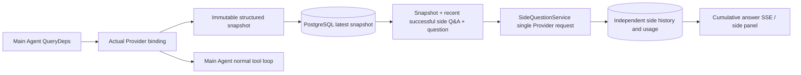

# ARTEX `/btw`

Normal chat, the task MainAgent, and the current task's own Workers support independent side questions. Type `/btw question` in the main input to submit; an empty `/btw` or the "Side Question" button opens history. Desktop uses a resizable sidebar; mobile uses a Drawer.

Side answers are generated from the Agent context snapshot at submission time and support streaming display, follow-up questions, stop, and clear. Closing the panel, refreshing the page, or disconnecting SSE does not cancel the model request. Stopping affects only the current side question; clearing cancels the side question and deletes side-question history while keeping the main context snapshot.

## Implementation Boundaries

Uses Go, norma v0.3.7, Next.js, and the existing Markdown / ResizablePanel / Drawer / AlertDialog components; no norma source was modified and no dependencies were added for side questions. Planner, Workers inherited from other tasks, and tool-type subtask escalation are out of scope for this round.

- `capture.go` only marks main-loop requests via `Options.Deps.CallModel / CallModelSync`. The Provider decorator sits inside the concrete model, after routing-pool selection, so the actually-selected model is recorded; compaction and summary requests do not overwrite the snapshot.
- Snapshots are published at request start, on complete model reply, and at run terminal state. A half-generated reply in progress is not published; tool calls stay paired via norma's `MessagesForAPI`, and tool results enter the snapshot at the next main model request or run terminal state. Streaming abort keeps the last valid boundary.
- Snapshots preserve structured messages, system prompts, tool definitions, and generation parameters via JSON deep copy. Model inference holds no snapshot lock or database transaction.
- `SideQuestionService` calls the concrete Provider; it generates a side summary first when necessary, and the final answer is allowed at most one reduced retry only on the first context-overflow error before any text/tool call has been output. It creates an agent session, does not hook into the tool executor, main transcript, activity stream, or task graph, and does not go through the task model-switching chain. Answers retain tool definitions for compatibility with existing structured tool contexts; summary requests provide no tools. Newly returned tool calls have no execution path.
- One running request per parent session, at most four per service process, with a 120-second timeout per request. Side questions use an independent cancel context under the service lifecycle.
- Side-question requests retain the model configuration reference and a non-sensitive identity summary; credentials are taken from the existing configuration at request time. If the configuration is deleted, or identity fields such as model, protocol, or address change, the main Agent must run first to update the snapshot. Tests do not change the product default model.

## Persistence and Recovery

`db/schema.sql` automatically creates `side_question_sessions` and `side_question_requests`. The former stores the parent resource, latest snapshot, run number, version, and cleanup version; the latter stores the question, cumulative answer, status, model, snapshot time, usage, event ordinal, and pagination ordinal.

The parent session key uses the conversation ID, or task ID + exploration ID + intent ID. Workers do not use reusable execution-slot naming.

Snapshots are merged and written per parent session, refreshed every 250 ms, with database comparison of `(run_id, version)` preventing old-version overwrites. The selected snapshot is saved again before side-question submission. After a successful save, the large in-memory snapshot is released; on failure the pending version is kept. Cumulative answer content is written at most every 250 ms as streaming events arrive, saved immediately at terminal state, and retried a limited number of times on database errors.

Service startup marks leftover `running` requests as `interrupted`, keeping the partially-saved answers and usage already persisted, and does not automatically replay requests. The most recently successfully saved context can be used directly for the next question. When an old session has no snapshot, the main Agent must run first; context is not rebuilt from UI activity records.

The clear operation increments the cleanup version and deletes requests; conditional updates prevent late callbacks from writing back. Physical parent-resource deletion relies on foreign-key cascade; Worker logical deletion deletes side-question data in the same transaction and rejects subsequent late snapshots. Task archiving first blocks new requests, waits for the main flow to stop, cancels and waits for side-question persistence; the archive format is v3, also compatible with v1/v2 that lack the side-question tables.

History is fully preserved, returning at most 20 items per page by ordinal cursor. Model requests replay at most the original text of the most recent 20 successful Q&A pairs, with replay volume also limited by a token budget; older Q&A maintains an independent rolling summary. When the main context exceeds budget, only the old part of the side-question copy is summarized, retaining recent structured tool calls and results. Summary, preparation progress, and usage are all included in the side question's concurrency, cancellation, and 120-second timeout limits. See [Context Budget and Open-Source References](CONTEXT_BUDGET.md) for details.

## HTTP Contract

The following paths serve as `{parent}`, reusing existing authentication and resource validation:

- `/api/conversations/{id}`
- `/api/tasks/{id}/chat`
- `/api/tasks/{id}/intents/{iid}`

| Request | Response and behavior |
| --- | --- |
| `GET {parent}/side-questions?before={ordinal}` | `items` ordered newest-first, independent `current` running state, `snapshot` metadata, `next_cursor`; cursor 0 means latest page / no next page |
| `POST {parent}/side-questions` | JSON `{ "question": "…", "client_request_id": "UUID" }`; a new request returns 202 and the request object; the same ID and question return the existing object with 200 |
| `DELETE {parent}/side-questions` | Cancels and clears the current parent session's side Q&A |
| `GET /api/side-questions/{requestID}/events` | `snapshot` SSE events, `id` is an increasing ordinal, `data` is the complete cumulative request object; `cleared` is sent on clear |
| `POST /api/side-questions/{requestID}/cancel` | Explicit cancel; the terminal state can be read from history or SSE |

Question limit is 4000 characters. No snapshot, model configuration change, the same parent session busy, or idempotent ID conflict return 409; the global concurrency cap returns 429. Every SSE connection first sends the cumulative state and does not depend on text fragments previously received by the client. The frontend merges by request ID + ordinal and discards old callbacks when switching parent sessions or clearing.

## Validation and References

Automated checks, actual model usage, and known limitations are in [VALIDATION.md](VALIDATION.md).

For the independent request reference, see [Grok CLI side-question.ts (pinned commit)](https://github.com/superagent-ai/grok-cli/blob/fb97af83f06dca873281d60168430f06c8de6324/src/utils/side-question.ts); for run isolation, see [OpenCode (pinned commit)](https://github.com/anomalyco/opencode/tree/b3f1a96c6dd7adeb28b36dd11add1998fc84d67b). ARTEX's context uses norma's structured messages and does not adopt the approach of concatenating text from frontend logs.
