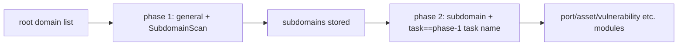

# ScopeSentry MCP User Guide

For users with a **deployed ScopeSentry instance**. Connect to the platform via Cursor (or another MCP client); no local source code needed.

## 1. Preparation

### 1.1 Confirm Service Accessibility

- Default Web UI: `http://<host>`
- MCP endpoint: `http://<host>/mcp` (if a reverse proxy or frontend proxy sits in front, use the actual `/mcp` address)

### 1.2 Create an API Key

1. Log in to the ScopeSentry Web UI in a browser
2. Go to the **API Key** management page to create a key (or create one via an admin-provided interface)
3. Save the returned `ssk_...` string (**shown only once**)

### 1.3 Configure Cursor MCP

Cursor → Settings → MCP → Add server:

```json
{
  "mcpServers": {
    "scopesentry": {
      "url": "http://<your-host>:8082/mcp",
      "headers": {
        "X-API-Key": "ssk_your-key"
      }
    }
  }
}
```

Alternatively use: `Authorization: Bearer ssk_your-key`

After configuration, restart MCP or reload Cursor and confirm that tools such as `list_projects` and `list_assets` appear in the tool list.

---

## 2. Tool Overview

| Tool | Purpose |
| --------------------- | ----------------- |
| `list_projects` | Project tree grouped by tag (including project IDs) |
| `list_projects_data` | Paginated project list, searchable by name |
| `get_project` | Project details |
| `create_project` | Create a new project |
| `list_tasks` | Scan task list |
| `get_task` | Task details |
| `list_scan_templates` | Scan template list |
| `get_scan_template` | Template details |
| `list_plugin_modules` | Scan pipeline module names |
| `list_plugins` | Available plugins (including hash, default parameters) |
| `create_scan_template` | Create a scan template |
| `create_scan_task` | Create a scan task |
| `list_assets` | Query all asset types (paginated list) |
| `count_assets` | Count assets (`/api/assets/common/total`) |
| `get_asset_detail` | Asset or vulnerability details |
| `add_asset_tag` | Add a tag to an asset |
| `list_nodes` | Scan node list |

Tool parameters follow the MCP tool descriptions (schema); the search and filter syntax of `list_assets` / `count_assets` is the same — read the `list_assets` description before querying assets.

When you need to know "how many in total", use `count_assets` (corresponding to the Web pagination total endpoint); there is no need to repeatedly page through `list_assets` just to count the total.

---

## 3. Common Workflows

### 3.1 Query Assets by Project

When the user or context **already has a project condition**, prioritize passing `filter.project` to narrow the scope and avoid slow responses from too much cross-project data. If there is no explicit project, a project filter is not mandatory.

1. `list_projects` or `list_projects_data` to get the target project's **ObjectID** (`id` / `children[].value`)
2. `list_assets` with `filter.project` (**must be the ID, not the project's Chinese name**)

```json
{
  "asset_type": "asset",
  "pageIndex": 1,
  "pageSize": 20,
  "search": "domain=^example.com",
  "filter": {
    "project": ["<project ObjectID>"]
  }
}
```

### 3.2 Create a Scan Task

1. `list_nodes` to get online node names
2. `list_scan_templates` or `create_scan_template` to get a template's **ObjectID**
3. `create_scan_task`: `name` and `node` are required; `template` takes the template ID (not the template name)

**Target source `targetSource` (consistent with the Web UI):**

| targetSource | Description | Required parameters |
| --- | --- | --- |
| `general` | Enter targets directly | `target` |
| `project` | Read targets from a project | `project` (array of project ObjectIDs) |
| `asset` | Search from the Web asset library | `search`; optional `project`, `filter`, `targetNumber` |
| `RootDomain` | Search from the root-domain library | `search`; optional `project`, `filter`, `targetNumber` |
| `subdomain` | Search from the subdomain library | `search`; optional `project`, `filter`, `targetNumber` |
| `UrlScan` | Search from URL scan results | `search`; optional `project`, `filter`, `targetNumber` |
| `*Source` (e.g. `subdomainSource`) | Create from the asset page's "selected/searched" | use `search` when `targetTp=search`; use `targetIds` when `targetTp=select` |

**Example — directly scan root domains:**

```json
{
  "name": "example-subdomain-collection",
  "node": ["node-1"],
  "template": "<template ObjectID>",
  "targetSource": "general",
  "target": "example.com\nfoo.com",
  "project": ["<project ObjectID>"]
}
```

**Example — continue scanning from the subdomain library (filtered by previous task name):**

```json
{
  "name": "example-port-and-vulnerability",
  "node": ["node-1"],
  "template": "<follow-up module template ObjectID>",
  "targetSource": "subdomain",
  "search": "task==\"example-subdomain-collection\"",
  "project": ["<project ObjectID>"]
}
```

### 3.3 Root Domain Full Information Collection (recommended two phases)

When the input is a **root domain** and **full information collection** is required, it is recommended to split into two scans rather than running the whole pipeline at once.

**Reason:** distributed tasks are dispatched in units of a **single target**. When a root domain is the target, subdomains scanned out by a node that received that root domain will also continue executing subsequent modules on that node, which easily causes uneven load, slow speed, and error-proneness.

**Best practice:**

1. **Phase 1 — subdomain collection only**
    - `targetSource`: `general`
    - `target`: all root domains (multiple lines)
    - Template: enable only `SubdomainScan`, `SubdomainSecurity` (subdomain scanning + subdomain takeover)
    - Use `get_task` to wait for task completion

2. **Phase 2 — follow-up modules**
    - `targetSource`: `subdomain`
    - `search`: `task=="<phase-1 task name>"` (exact match on task name)
    - Optional `project` to narrow scope
    - Template: port scanning, asset mapping, vulnerability scanning, etc. (may exclude SubdomainScan)
    - Subdomains are dispatched as independent targets to each node, with higher parallel efficiency

You can also filter by task name on the Web UI's "Subdomain" asset page and use "Create task from subdomains", which has the same effect.



### 3.4 Create a Scan Template

1. `list_plugin_modules` → module name list
2. `list_plugins` (filterable by `module`) → each plugin's `hash` and default `parameter`
3. `create_scan_template`: use `modules` to specify "module → array of plugin hashes"

---

## 4. Asset Queries (`list_assets` / `count_assets`)

`count_assets` and `list_assets` use the same `asset_type`, `search`, `filter`, and return `{ "total": N }`, corresponding to the Web `/api/assets/common/total`.

```json
{
  "asset_type": "subdomain",
  "search": "task==\"some task name\"",
  "filter": {"project": ["<project ObjectID>"]}
}
```

**Performance advice (applies to `list_assets` / `count_assets`):** when a project condition exists, prioritize `filter.project` to narrow scope; in `search`, prefer `==` equality or `^` prefix matching on indexed fields (see [4.3](#43-search-search-expressions)) to avoid large-area `=` fuzzy queries slowing responses. When there is no project context, a project filter is not mandatory.

The supported types for `filter.project` are in the [4.4](#44-filter-exact-filtering) table.

### 4.1 Asset Types `asset_type`

`asset`, `RootDomain`, `subdomain`, `app`, `mp`, `UrlScan`, `SensitiveResult`, `DirScanResult`, `crawler`, `vulnerability`, `PageMonitoring`, `IPAsset`, `SubdomainTakerResult`

Alias examples: `web`→asset, `vuln`→vulnerability, `ip`→IPAsset, `url`→UrlScan

### 4.2 Parameter Descriptions

| Parameter | Description |
| ------------------------ | --------------------------------------- |
| `pageIndex` / `pageSize` | Pagination, default 1 / 20 |
| `search` | Search expression (see next section) |
| `filter` | Exact filter JSON (see next section) |
| `sort` | Only UrlScan and DirScanResult support sorting by `length` |
| `sid` | Only SensitiveResult: sensitive rule name |

`search` and `filter` **can be used together**.

### 4.3 search Search Expressions

Custom DSL (**not SQL**):

| Operator | Meaning | Indexed | Example |
| ---- | ---- | ---- | --------------------------- |
| `=` | fuzzy match (regex) | not indexed | `domain=example` |
| `==` | exact match (equality) | **indexed** | `port==443` |
| `!=` | exclusion | — | `port!="80"` |
| `&&` | and | — | `domain==example.com && port==443` |
| `||` | or | — | `title=admin || body=login` |

**Indexes and operators:** fields such as `domain`, `ip`, `port`, `title` are indexed, but only **`==` equality** or **prefix matching where the value starts with `^`** (such as `domain=^example.com`) can use the index; **`=` converts to regex fuzzy matching and cannot use the index**, which is slow on large datasets.

**search fields common to all types:** `tag`, `task` (task name), `rootDomain`

**project cannot be written in search** (invalid or errors when combined with `&&`). To filter by project, use `filter.project`.

**Common search fields by type:**

| asset_type | Fields |
| -------------------- | ----------------------------------------------------------------------------------- |
| asset | domain, ip, port, service, app, title, statuscode, icon, banner, type, body, header |
| RootDomain | domain, icp, company |
| subdomain | domain, ip, type, value |
| app | name, icp, company, category, description, url, apk |
| mp | name, icp, company, category, description, url |
| UrlScan | url, input, source, resultId, type |
| SensitiveResult | url, sname, body, info, md5 |
| DirScanResult | url, statuscode, redirect, length |
| vulnerability | url, vulname, matched, request, response, level |
| crawler | url, method, body, resultId |
| PageMonitoring | url, hash, diff, response |
| IPAsset | ip, domain, port, service, webServer, app |
| SubdomainTakerResult | domain, value, type, response |

**search examples:**

- `domain==www.example.com && port==443` (equality, indexed)
- `domain=^example.com` (prefix match, indexed)
- `ip==192.168.1.1`
- `task=="some task name"`
- `level==high` (vulnerability)
- `statuscode==200` (DirScanResult)

Use `=` when fuzzy containment is needed, such as `title=admin` (not indexed; best combined with conditions like project to narrow scope).

### 4.4 filter Exact Filtering

JSON object: multiple values for the same key are **OR**, different keys are **AND**.

**Prioritize `project` when a project condition exists:** if the user or context already specifies a project and the asset_type supports `project`, pass it to narrow scope; it is not mandatory when there is no project information.

| filter key | Meaning | Value notes |
| ------------ | -------- | -------------------------------------------------------- |
| `project` | Owning project | **ObjectID**, obtained via `list_projects` / `list_projects_data` |
| `task` | Source task | **task name**, from `list_tasks`'s `name` |
| `port` | Port | e.g. `"443"` |
| `service` | Service/protocol | e.g. `"https"` |
| `app` | Application fingerprint | e.g. `"Nginx"` |
| `icon` | Icon hash | |
| `statuscode` | HTTP status code | mainly for asset |
| `status` | Status | UrlScan/DirScan HTTP codes; vulnerability/sensitive-info processing status |
| `level` | Vulnerability level | critical / high / medium / low / info |
| `type` | Type | e.g. subdomain record types A, CNAME |
| `color` | Sensitive-rule color | SensitiveResult |
| `sname` | Sensitive-rule name | SensitiveResult |
| `tags` | Tags | |

**Available filter keys by type:**

| asset_type | filter key |
| ------------------------------------- | --------------------------------------------------------------- |
| asset | project, port, service, app, icon, statuscode, type, task, tags |
| RootDomain | project, tags |
| subdomain | project, type, task, tags |
| app / mp | project, tags |
| UrlScan | status, tags |
| DirScanResult | status, tags |
| SensitiveResult | status, color, sname, tags |
| crawler | project, task, tags |
| vulnerability | project, level, status, task, tags |
| PageMonitoring / SubdomainTakerResult | tags |
| IPAsset | project, port, service, app |

**filter example:**

```json
{"project": ["<project ObjectID>"], "port": ["443"]}
```

**Combined query example:**

```json
{
  "asset_type": "asset",
  "search": "domain=^baidu && port==443",
  "filter": {"project": ["<project ObjectID>"]},
  "pageIndex": 1,
  "pageSize": 10
}
```

**Notes:**

- When a project condition exists, prioritize passing `filter.project` (where supported); it is not mandatory without project context
- Do not put the project display name in `filter.project`
- Use `==` for known values and `^` for prefixes; avoid abusing `=` fuzzy matching on large tables
- For UrlScan HTTP status, use `filter.status`; DirScanResult can use `statuscode==200` in search
- For SensitiveResult by rule name: use `sname=rule name` in `search`, or `filter.sname`

### 4.5 Sorting sort

Only **UrlScan** and **DirScanResult** support it:

```json
{"length": "ascending"}
```

Other types ignore `sort` and sort by time by default.

---

## 5. Scan Template Module Names

`TargetHandler`, `SubdomainScan`, `SubdomainSecurity`, `PortScanPreparation`, `PortScan`, `PortFingerprint`, `AssetMapping`, `AssetHandle`, `URLScan`, `WebCrawler`, `URLSecurity`, `DirScan`, `VulnerabilityScan`, `PassiveScan`

---

## 6. Troubleshooting

| Symptom | Handling |
| --------- | -------------------------------------------------- |
| MCP has no tools | Check URL, API Key, and whether ScopeSentry is running |
| 401 / 403 | Recreate or replace the API Key |
| Assets not found | Confirm `filter.project` is an ObjectID; do not write project in search |
| Template/task creation failed | `template` must be the template ObjectID; `node` takes an online node name |
| Query very slow / stuck | Add `filter.project` when there is a project; use `==` or `^` prefix on indexed fields in search, use `=` less; reduce `pageSize` |

---
